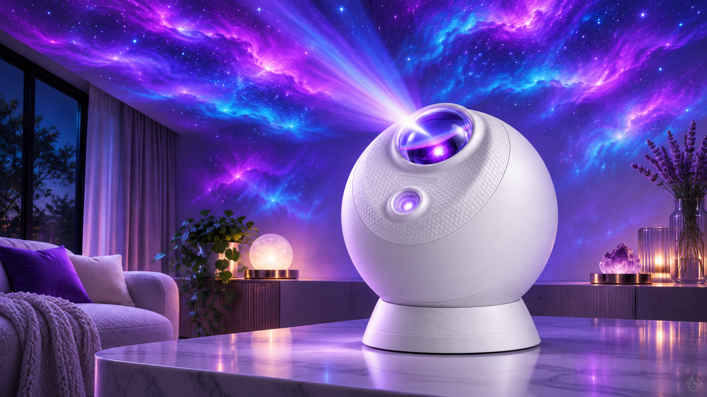

# ESPHome for BlissLights Evolve

<a href="https://esphome.io/">
  <picture>
    <source media="(prefers-color-scheme: dark)" srcset="images/esphome-logo-on-dark.svg">
    
  </picture>
</a>

An independent ESPHome project for the BlissLights Evolve **SKY-EVOLVE-B-RCWB** with a **Tuya CBU (BK7231N)** module. It lets you control the RGBW nebula, laser and rotation over your local network using Home Assistant.

**Android app in development.** I’m building a companion app for anyone who wants to control the projector directly over their local network without setting up Home Assistant.

## Get started

1. **Build the firmware.** Follow the guide to prepare your private configuration and build the firmware. [Build guide](docs/build.md)
2. **Install and verify.** Read the flashing and safety instructions before opening the projector. [Flashing guide](docs/flash.md)
3. **Connect to Home Assistant.** Add the projector through the ESPHome integration. Start here if ESPHome is already installed. [Connection guide](docs/connect.md)

## Reference

- GPIO assignments, adapter connections and PCB photographs. [Hardware and UART wiring](docs/wiring.md)
- Wi-Fi, firmware verification and logging. [Troubleshooting](docs/troubleshooting.md)
- Restore the original firmware from a complete raw flash image. [Recovery guide](docs/recovery.md)
- Review firmware changes by version. [Changelog](CHANGELOG.md)

## Credits

[Dawk323](https://www.elektroda.com/rtvforum/topic3984240.html) provided the ESPHome configuration and original firmware reference. [helge1](https://www.elektroda.com/rtvforum/topic3984240.html#21136263) contributed configuration feedback.

The ESPHome logo is a trademark of the Open Home Foundation. [Official ESPHome brand assets](https://github.com/OpenHomeFoundation/brand-assets/tree/main/esphome)
