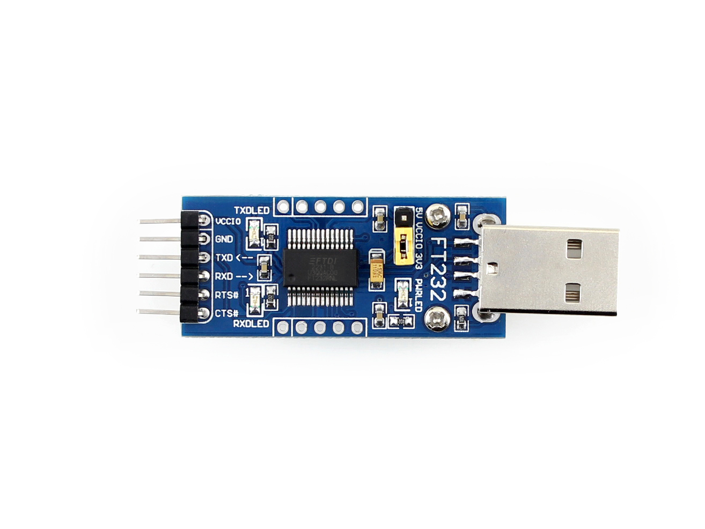

# Flash ESPHome firmware

For the **BlissLights Evolve SKY-EVOLVE-B-RCWB** with the **Tuya CBU / BK7231N** module.

> [!WARNING]
> Disconnect all power before opening or rewiring the projector. Electrically unplug the laser before powering the opened device or flashing firmware. See [power and laser safety](#power-supply---required).

[Preparation](#before-connecting-the-projector) · [Wiring](#wiring) · [Flashing](#flash-sequence) · [CEN reset for the first flash](#cen-reset-for-the-first-flash) · [First boot](#verify-after-first-boot) · [Troubleshooting](#if-a-step-fails)

## Flashing adapter used

**Waveshare FT232 USB UART Board (Type A), SKU 6170**, with 3.3 V TTL logic.



*Manufacturer's product photo.* [Waveshare product page](https://www.waveshare.com/ft232-usb-uart-board-type-a.htm)

## Before connecting the projector

### Power supply - required

- **Power the projector PCB from its original adapter.** The Waveshare board cannot supply enough current.
- **Use the 3.3 V jumper for UART logic only.** Keep FT232 VCCIO, 3V3 and 5V disconnected from the projector's power pins.
- Connect only crossed **TXD/RXD** and a shared **GND** between the FT232 and projector. The separate reset bridge connects **GND to CEN** briefly.
- Disconnect both power sources before changing the wiring.

### Disconnect the laser

The manufacturer's rear label identifies the projector as a **Class 2 laser product** (IEC 60825-1 Ed. 3, 2014, diode laser, maximum output <1 mW).

- With all power off, identify the actual laser connector on the hardware. Wire colors alone are insufficient.
- **Unplug the laser module from the main PCB** and insulate the disconnected connector. Software-off and motor disconnection cannot provide electrical isolation for the laser.
- Leave the laser unplugged during serial flashing and initial checks. Reconnect it only with power off, after verifying the other functions, and for operation with the enclosure closed.

### Check ltchiptool and keep a backup

- Run the commands from the repository root. Install **ltchiptool 4.15.0**, or verify the version and command syntax of your existing installation. [Build guide](build.md#install-ltchiptool-for-image-inspection-and-serial-flashing)
- Back up the checked UF2, its recorded **SHA-256** and the matching private YAML. Flash only an image built with that private configuration.
- Keep a verified backup from **your projector** before overwriting it if you need to preserve the previous installation, device identity or settings. The community recovery reference comes from another device. [Recovery reference](recovery.md)

```bash
command -v ltchiptool
ltchiptool --version
ltchiptool flash write --help
```

### Find and check the serial port

Plug the USB adapter into the computer with the projector disconnected.

```bash
ls -l /dev/serial/by-id/
ls -l /dev/ttyUSB*
```

- Identify the adapter by unplugging and reconnecting it if needed. Prefer its stable `/dev/serial/by-id/…` path. Treat USB detection as a check of adapter presence only. Verify UART voltage and PCB wiring separately.
- Set `PORT` to the actual adapter path. Use `/dev/ttyUSB0` in the example only if it is the port you identified.

```bash
PORT=/dev/ttyUSB0
ls -l "$PORT"
id
fuser "$PORT"
```

| Check | Action |
| --- | --- |
| Port busy | Close ESPHome log viewers, serial terminals and any other process using the port. |
| `fuser` exits with status 1 | This usually means no process has the port open. |
| `fuser` unavailable | Install Debian's `psmisc` package or check port use with the system tools you already have. |
| `Permission denied` | Check the device's group and your membership. Debian commonly uses `dialout`. Obtain the appropriate group access and log in again. Keep the toolchain under your regular user and retain the device's normal access restrictions. |

### Check the exact image

In the terminal where you set `PORT`, select the exact UF2 from your private build. [Build guide](build.md)

```bash
UF2=firmware/esphome/.esphome/build/galaxy-lamp-v0.3-dev/.pioenvs/galaxy-lamp/firmware.uf2
test -s "$UF2"
ltchiptool flash file "$UF2"
ltchiptool uf2 info "$UF2"
sha256sum "$UF2"
```

- **Stop if the file is missing or any check fails.** Both ltchiptool inspection commands read the local file without contacting the device.
- Require a recognized UF2 with family **BK7231N** and board **cbu**. Match the LibreTiny version to the one recorded for the intended build.
- Compare the **SHA-256** with the hash recorded for this exact private build or backup. Keep the same file for writing. A newly printed hash needs that known value for comparison.

## Wiring

1. Check that the adapter jumper selects **3V3** and verify the UART voltage is **3.3 V**.
2. Disconnect all power. Confirm the laser is unplugged and remove any FT232 TXD–RXD loopback wire.
3. Wire the disconnected projector and adapter as shown. A–E contacts in each numbered breadboard row are internally connected. [PCB photographs and breadboard layout](wiring.md#pcb-connections)

| PCB pad | PCB wire to breadboard | FT232 wire from breadboard |
| --- | --- | --- |
| RX | 6A (red) | 6E to TXD |
| TX | 8A (brown/gray) | 8E to RXD |
| GND | 10A (black) | 10E to GND |
| Reset / CEN | 12A | No direct FT232 connection |
| 3V3 | Not connected | Not connected |

Use **10B (GND)** and **12B (CEN)** for the momentary bridge while ltchiptool waits for the chip. [Reset bridge diagram](wiring.md#breadboard-reset-connection)

## Flash sequence

### CEN reset for the first flash

**If the projector is still running the original firmware, use the manual CEN reset in step 3 below.** Start ltchiptool first. Briefly grounding CEN holds the BK7231N in reset. Releasing CEN lets the chip start while ltchiptool is waiting on UART1, so the tool can establish the connection in download mode. [LibreTiny serial flashing reference](https://docs.libretiny.eu/docs/platform/beken-72xx/)

### Write and verify the transfer

1. **Power on.** Connect the Waveshare to the computer over USB, then connect the PCB to its original power adapter. Keep the laser disconnected.
2. **Start the write.** Confirm the checked port, image and wiring before you decide to flash.

   ```bash
   ltchiptool flash write -c -d "$PORT" -t 60 "$UF2"
   ```

3. **Enter download mode.** When ltchiptool waits for the chip, briefly bridge **10B (GND)** to **12B (CEN)** and release the bridge immediately.
4. **Wait for completion.** Keep power and the USB adapter connected and leave reset alone while the tool writes and verifies. Require **exit status 0 and no reported write or verification error**. Save the image hash and transfer result privately.

| Option | Purpose |
| --- | --- |
| `-d "$PORT"` | Uses the serial adapter you checked. |
| `-c` | Enables ltchiptool's hash and CRC checks. |
| `-t 60` | Allows 60 seconds to connect to the chip. Wi-Fi association after boot has its own timing. |

ltchiptool selects the baud rate automatically. The UF2 supplies the target layout, so leave out raw offsets, a transfer length and a separate erase command.

The writer normally starts the application after the transfer, with no manual reset required. Its verification covers the transfer. A complete independent flash readback and boot or Wi-Fi verification are separate checks.

## Verify after first boot

Keep the laser disconnected throughout open-enclosure checks.

1. **Wi-Fi.** Keep the configured **2.4 GHz** network available. Look for a **currently connected** projector and its current IP in the router. A saved router entry alone is insufficient. Use the router and encrypted API to confirm connection rather than relying on a fixed boot time.
2. **Encrypted API.** Connect with the key from the matching private YAML. Compare the reported firmware version and build time with the intended build when available. [Home Assistant connection guide](connect.md)
3. **Projector functions.** Test RGBW, motor and button separately. Treat a deliberate power-cycle test, repeated starts, OTA and longer observation as separate checks. Reconnect the laser only with power disconnected and for operation with the enclosure closed.

### Serial and API logging

- The supplied configuration disables normal ESPHome serial and API logging. A quiet terminal alone cannot establish a boot failure. The BootROM or SDK may still produce output.
- To enable ESPHome logging, build and flash a separate diagnostic configuration. [Logging instructions](troubleshooting.md#logging)

## If a step fails

- **Port missing or busy.** Recheck the port path, close its other users and resolve permissions before retrying. Disconnect both power sources before touching the wiring.
- **No chip connection.** Check original power, crossed TX/RX and shared GND. After a connection timeout, restart the command and repeat the brief CEN bridge once it waits again. Keep reset untouched during an active transfer.
- **Unexpected chip or layout, or repeated CRC errors.** Stop and recheck the image, wiring, voltage and power before another write. Keep verification enabled and use the supplied image layout.
- **Interrupted or failed write.** Treat firmware completeness as unknown. Keep the checked image and private error output. Correct the connection or power issue, then retry that same image. Leave full-chip erasure and another device's raw dump out of this retry.
- **Transfer succeeds but Wi-Fi or API is unavailable.** Check the running build and network separately. Verify application behavior separately after a successful transfer. Gather evidence before changing the MAC, GPIO assignments or framework. [Operational checks](troubleshooting.md)

## References

- [LibreTiny CBU](https://docs.libretiny.eu/boards/cbu/)
- [Beken serial flashing](https://docs.libretiny.eu/docs/platform/beken-72xx/)
- [ltchiptool](https://docs.libretiny.eu/docs/flashing/tools/ltchiptool/)
