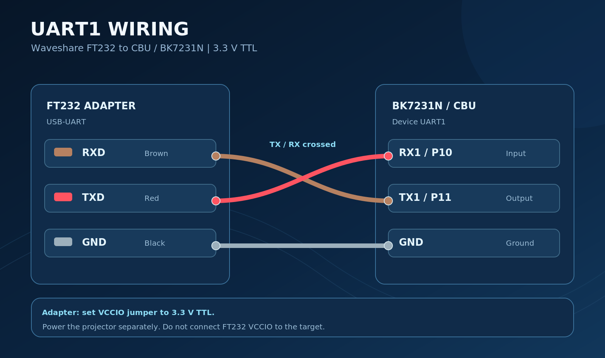
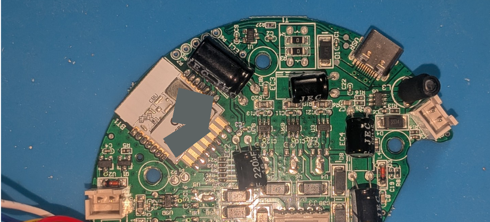
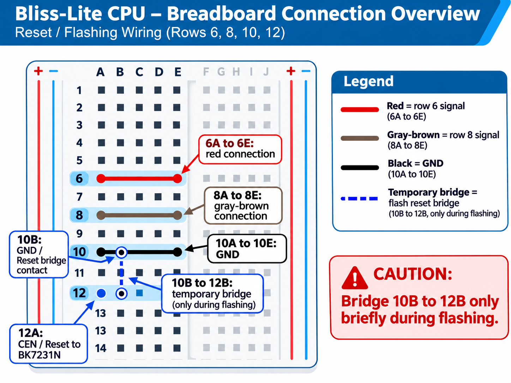

# Waveshare FT232 USB UART Board (Type A, SKU 6170)

USB-A adapter with FT232RL, used for UART1 on the **CBU / BK7231N**. [Manufacturer specifications](https://www.waveshare.com/product/ft232-usb-uart-board-type-a.htm).

## Wiring

**Power supply: use the projector's original power adapter.** The Waveshare FT232 USB UART Board (Type A, SKU 6170) cannot supply enough current for the projector PCB. The 3.3 V jumper sets UART logic voltage, not PCB power. **Never connect FT232 VCCIO, 3V3 or 5V to the PCB power pins.** Connect a common GND and crossed TXD/RXD only; use GND briefly for CEN reset. Disconnect all power before changing wiring.

| FT232 | CBU / BK7231N |
| --- | --- |
| GND | GND |
| TXD | RX1 / P10 / GPIO10 |
| RXD | TX1 / P11 / GPIO11 |
| RTS, CTS, DTR | Not connected |
| GND briefly | CEN (manual reset only) |

Confirm the actual board pads and jumper positions before wiring. Do not assume that an FT232 USB ID identifies the jumper setting.

Header pin order with USB-A at the bottom: **CTS#, RTS#, RXD, TXD, GND, VCCIO** (left to right). Set the yellow VCCIO jumper between **VCCIO and 3V3**. Verify the voltage before connecting the projector.




## PCB connections

**Component side (CBU module)**



**Solder side (UART pads)**


**Serial pad detail**


The illustrated example connects the PCB solder-side pads to the breadboard as follows; contact positions and wire colors apply only to this layout:

| PCB pad | Breadboard (PCB side) | Breadboard (FT232 side) | FT232 |
| --- | --- | --- | --- |
| RX | 6A (red) | 6E | TXD |
| TX | 8A (brown/gray) | 8E | RXD |
| GND | 10A (black) | 10E | GND |
| Reset / CEN | 12A | 12B for momentary GND bridge | No direct connection |
| 3V3 | Not connected | Not connected | Not connected |

The A-E contacts within each numbered row are internally connected. Briefly bridge **10B (GND)** to **12B (CEN)** for reset, then remove the bridge.

## Breadboard reset connection



In the illustrated breadboard layout, rows A-E are internally connected. **10B is GND** and **12A carries CEN**. Briefly bridge **10B to 12B** to reset the BK7231N, then remove the bridge.


## Adapter check (projector disconnected)

```bash
lsusb -d 0403:6001
ls -l /dev/serial/by-id/
ls -l /dev/ttyUSB*
fuser /dev/ttyUSB0 || true
```

Use the actual adapter port in the commands below. USB detection confirms the adapter is present; it does not prove UART wiring or communication with the projector. Keep TXD and RXD crossed to the PCB as illustrated, without an adapter TXD–RXD bridge.

## Image preflight (no serial connection)

```bash
UF2=firmware/esphome/.esphome/build/galaxy-lamp-v0.3-dev/.pioenvs/galaxy-lamp/firmware.uf2
test -s "$UF2" && sha256sum "$UF2"
```

Verify UF2 metadata and flash address ranges for BK7231N before writing. An ESPHome UF2 is not a raw flash dump.

## Chip identification (requires download mode)

Disconnect the laser before powering the opened device. Connect the crossed UART1 lines and GND, then power the projector from its original supply. This identification does not write flash, but entering download mode interrupts the running firmware.

```bash
ltchiptool flash info bk7231n -d /dev/ttyUSB0
```

While the tool waits for a connection, briefly pull **CEN to GND** and release it. Confirm the BK7231N device identity and flash capacity. Do not hold CEN low continuously.

**Disconnect the laser module electrically before flashing.** See [ESPHome serial flashing](flash.md) for the safety requirements and steps. A UF2 application and a [full raw recovery image](recovery.md) are different image types.
