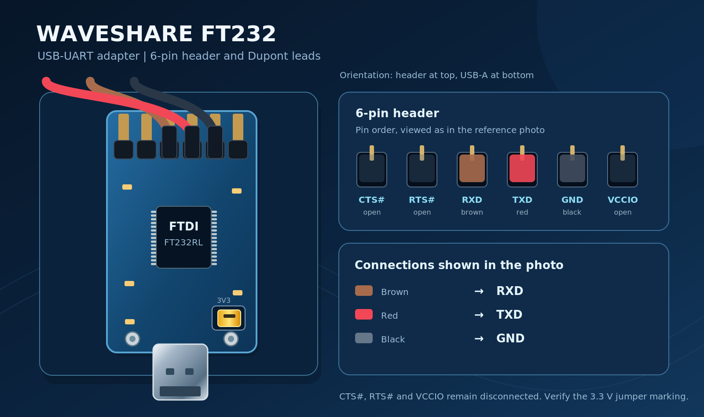
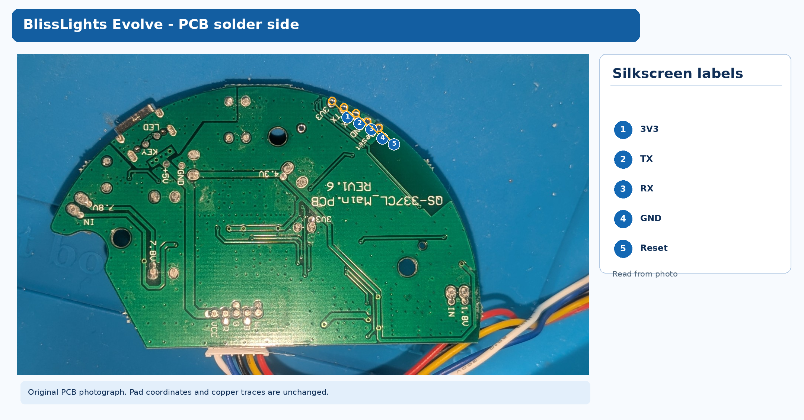
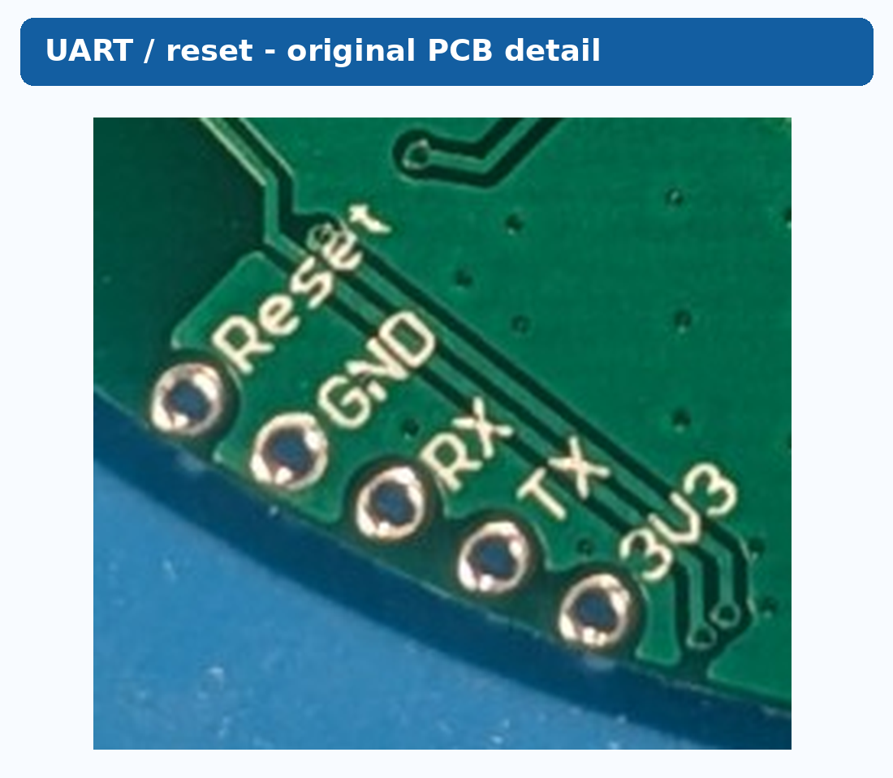
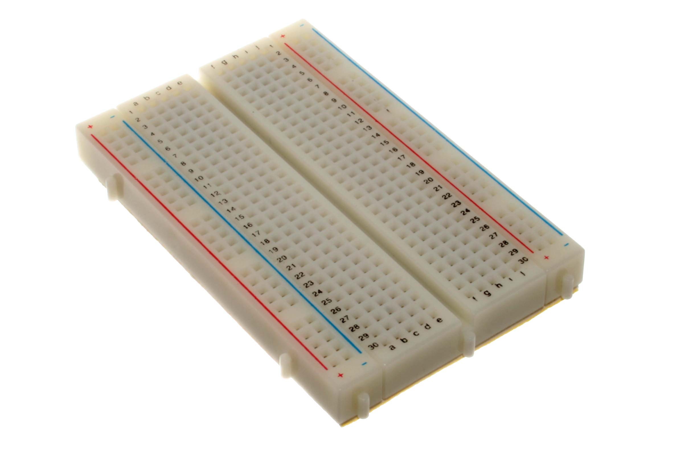

# Hardware and UART wiring

This guide covers the **CBU / BK7231N** board in the BlissLights Evolve. The UART1 instructions use the **Waveshare FT232 USB UART Board (Type A, SKU 6170)**, a USB-A adapter with the FT232RL chip. [Adapter specifications](https://www.waveshare.com/product/ft232-usb-uart-board-type-a.htm)

## Model compatibility

Use the **Evolve UF2, UART pinout and raw recovery image only on matching Evolve hardware**. [Evolve hardware and related models](devices/evolve.md) · [Nigecue SK20 hardware](devices/sk20.md)

## Wiring

**Power supply: use the projector's original power adapter.** The Waveshare FT232 USB UART Board (Type A, SKU 6170) cannot supply enough current for the projector PCB. The 3.3 V jumper sets UART logic voltage, not PCB power. **Never connect FT232 VCCIO, 3V3 or 5V to the PCB power pins.** Connect a common GND and crossed TXD/RXD only; use GND briefly for CEN reset. Disconnect all power before changing wiring.

| FT232 | CBU / BK7231N |
| --- | --- |
| GND | GND |
| TXD | RX1 / P10 / GPIO10 |
| RXD | TX1 / P11 / GPIO11 |
| RTS, CTS, DTR | Not connected |
| GND briefly | CEN (manual reset only) |

Confirm the actual board pads and jumper positions before wiring. Do not assume that an FT232 USB ID identifies the jumper setting.

Header pin order with USB-A at the bottom: **CTS#, RTS#, RXD, TXD, GND, VCCIO** (left to right). Set the yellow VCCIO jumper between **VCCIO and 3V3**. Verify the voltage before connecting the projector.




## PCB connections

**Component side (CBU module)**


**Solder side (UART pads)**



**Serial pad detail**



### Read the breadboard

A solderless breadboard lets you join jumper wires temporarily by plugging them into shared contacts. The example below has 400 holes.



*BREB-01 by oomlout.* [Wikimedia Commons](https://commons.wikimedia.org/wiki/File:400_points_breadboard.jpg) · [CC BY-SA 2.0](https://creativecommons.org/licenses/by-sa/2.0/)

- **Read a hole by row and column.** `10B` means row 10, column B. `12B` is two rows farther down in the same column.
- **Each row has two groups of five connected holes.** A–E form one group and F–J form the other. The center gap separates them. For example, `6A` and `6E` share a contact, while `6F` belongs to the other group.
- **Leave the red and blue side rails unused.** The wiring below uses only the numbered rows in the A–E group.

### Choose the jumper wires

Dupont jumper wires are short, reusable leads. They are common in prototypes and temporary test setups because the 2.54 mm versions fit standard breadboards and pin headers like the one on the FT232 adapter. You can plug in, move or remove the wires at those points by hand, without soldering. That makes it easy to remove the adapter after flashing.

A **male** end has an exposed metal pin that plugs into a breadboard. A **female** end has a socket that slips over a header pin.

| Jumper wire | Where to use it |
| --- | --- |
| Male–female (M–F) | Use three for **TXD**, **RXD** and **GND**. Push each female socket onto the corresponding FT232 header pin and plug the male end into the matching breadboard hole in the table below. |
| Male–male (M–M) | Use one as the temporary **GND-to-CEN** reset bridge between `10B` and `12B`. |
| Female–female (F–F) | Joins two exposed header pins. The breadboard connections in this layout need a male end. |

The projector PCB has bare solder pads at these points. Use securely attached leads from **RX**, **TX**, **GND** and **CEN**, with a pin or solid wire end that fits the breadboard. If the PCB already has a male header fitted at those pads, use male–female jumpers there as well. Follow the signal labels when placing the wires. The colors in the table only help identify the wires in this example.

### Example wiring

Use the numbered breadboard rows to join each PCB lead to its matching adapter wire. [Breadboard wiring and reset diagram](#breadboard-reset-connection)

| PCB pad | Breadboard (PCB side) | Breadboard (FT232 side) | FT232 |
| --- | --- | --- | --- |
| RX | 6A (red) | 6E | TXD |
| TX | 8A (brown/gray) | 8E | RXD |
| GND | 10A (black) | 10E | GND |
| Reset / CEN | 12A | 12B for momentary GND bridge | No direct connection |
| 3V3 | Not connected | Not connected | Not connected |

During the reset step, briefly bridge **10B (GND)** to **12B (CEN)** and remove the bridge.

## Breadboard reset connection


In the diagram, **10B shares GND with 10A**, and **12B shares CEN with 12A**. Use the male–male jumper to make the brief reset bridge shown above.

## Firmware pin assignments

The published configuration uses these CBU / BK7231N pins. [Firmware YAML](../firmware/esphome/galaxy-evolve-v0.3-dev.yaml)

| Function | GPIO |
| --- | --- |
| Nebula red | GPIO6 |
| Nebula green | GPIO26 |
| Nebula blue | GPIO24 |
| Nebula white | GPIO9 |
| Laser | GPIO8 |
| Motor | GPIO7 |
| Button | GPIO14 |
| Status LED | GPIO0 |
| UART1 RX / TX | GPIO10 / GPIO11 |

## Adapter check (projector disconnected)

```bash
lsusb -d 0403:6001
ls -l /dev/serial/by-id/
ls -l /dev/ttyUSB*
fuser /dev/ttyUSB0 || true
```

Use the actual adapter port in the commands below. USB detection confirms the adapter is present; it does not prove UART wiring or communication with the projector. Keep TXD and RXD crossed to the PCB as illustrated, without an adapter TXD–RXD bridge.

## Image preflight (no serial connection)

```bash
UF2=firmware/esphome/.esphome/build/galaxy-lamp-v0.3-dev/.pioenvs/galaxy-lamp/firmware.uf2
test -s "$UF2" && sha256sum "$UF2"
```

Verify UF2 metadata and flash address ranges for BK7231N before writing. An ESPHome UF2 is not a raw flash dump.

## Chip identification (requires download mode)

Disconnect the laser before powering the opened device. Connect the crossed UART1 lines and GND, then power the projector from its original supply. This identification does not write flash, but entering download mode interrupts the running firmware.

```bash
ltchiptool flash info bk7231n -d /dev/ttyUSB0
```

While the tool waits for a connection, briefly pull **CEN to GND** and release it. Confirm the BK7231N device identity and flash capacity. Do not hold CEN low continuously.

**Disconnect the laser module electrically before flashing.** See [ESPHome serial flashing](flash.md) for the safety requirements and steps. A UF2 application and a [full raw recovery image](recovery.md) are different image types.
